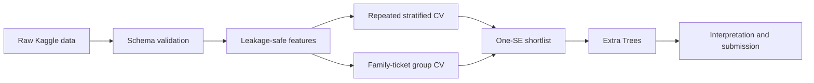

# Titanic Survival Prediction

[English](README.md) | [简体中文](README.zh-CN.md)

An end-to-end tabular machine-learning project rebuilt from an unfinished
student exercise. The repository emphasizes leakage-safe preprocessing,
related-passenger-aware validation, statistically cautious model selection,
interpretation on held-out groups, and reproducible Kaggle evidence.

## Highlights

- Replaced target-leaking age imputation with fold-fitted preprocessing.
- Compared four model families against a majority-class baseline.
- Combined repeated stratified CV with connected family-ticket group validation.
- Selected models using a one-standard-error shortlist and robustness tie-break.
- Improved the Kaggle score from 0.77751 to 0.78229.
- Added tests, CI, versioned submissions, a model card, and bilingual documentation.

## Workflow



## Results

The main comparison uses shuffled five-fold stratified cross-validation repeated
three times. A second test keeps connected family and ticket groups in the same
fold to measure robustness to related-passenger leakage.

| Model | Repeated CV accuracy | Group-aware accuracy | ROC-AUC |
|---|---:|---:|---:|
| Extra trees | 0.8279 +/- 0.0169 | **0.8238 +/- 0.0268** | 0.8797 |
| Logistic regression | 0.8279 +/- 0.0261 | 0.8170 +/- 0.0240 | 0.8700 |
| Random forest | **0.8286 +/- 0.0199** | 0.8115 +/- 0.0285 | 0.8802 |
| Gradient boosting | 0.8271 +/- 0.0219 | 0.8103 +/- 0.0216 | 0.8827 |
| Majority-class baseline | 0.6162 | 0.6162 | 0.5000 |

The highest repeated-CV scores are statistically indistinguishable. The project
therefore applies a one-standard-error rule and chooses the shortlisted model
with the best group-aware accuracy. This selects **extra trees**, rather than
overinterpreting the random forest's 0.0007 point-estimate advantage.

The submitted v1 random-forest model scored **0.77751 on Kaggle**. The more
robust v2 extra-trees model changed 12 of 418 predictions and scored
**0.78229**, an absolute improvement of 0.00478 (0.478 percentage points).
Each scored submission is retained separately so later training runs cannot
overwrite the evidence behind a reported result.

| Submission | Model | Kaggle score | Change |
|---|---|---:|---:|
| v1 | Random forest | 0.77751 | - |
| v2 | Extra trees | **0.78229** | **+0.00478** |


Held-out permutation importance identifies sex as the strongest source feature,
followed by name-derived title/length, family relationships, and passenger
class. Fare has near-zero, slightly negative importance, but the effect is within
cross-fold variation and is not treated as sufficient evidence for deletion.

## What the project demonstrates

- validation of the original train/test data schema;
- feature engineering for title, family structure, ticket groups, cabin deck,
  ticket prefix, and fare per passenger;
- missing-value imputation and one-hot encoding inside a scikit-learn pipeline;
- repeated stratified and family-ticket-group-aware cross-validation;
- comparison against a majority-class baseline;
- comparison of linear, bagged-tree, and boosted-tree classifiers;
- one-standard-error model selection with a group-robustness tie-break;
- held-out, group-aware permutation importance;
- generation and validation of a Kaggle-compatible submission file;
- saved metrics, diagnostic figures, and a reusable fitted pipeline.

## Project structure

```text
titanic-portfolio/
|-- data/raw/                 # Local Kaggle data; CSV files are not tracked
|-- docs/                     # Analysis, resume, and interview materials
|-- outputs/submissions/      # Versioned scored and candidate submissions
|-- reports/                  # Metrics and diagnostic figures
|-- src/features.py           # Leakage-safe feature engineering
|-- src/validation.py         # Connected family-ticket validation groups
|-- src/train.py              # Evaluation, selection, and export workflow
|-- tests/                    # Feature and validation tests
|-- MODEL_CARD.md
|-- requirements.txt
`-- README.md
```

The unedited student-era script is retained locally under `archive/` for
comparison but intentionally excluded from the public repository.

Additional documentation:

- [Analysis summary](docs/analysis_summary.md)
- [Model card](MODEL_CARD.md)
- [Chinese resume wording](docs/resume_project_zh.md)
- [Chinese interview guide](docs/interview_guide_zh.md)
- [GitHub release checklist](docs/github_release_checklist.md)
- [Version history](CHANGELOG.md)

## License

Project code is released under the [MIT License](LICENSE). The Kaggle competition
data is not redistributed in this repository.

## Reproduce the analysis

First join the Kaggle competition, accept its rules, and place `train.csv`,
`test.csv`, and `gender_submission.csv` in `data/raw/`. Then run:

```powershell
.\scripts\run_project.ps1
```

Or run the steps manually:

```powershell
python -m venv .venv
.\.venv\Scripts\Activate.ps1
python -m pip install -r requirements.txt
python -m unittest discover -s tests -v
python -m src.train
```

The training command creates:

- `reports/model_comparison.csv`;
- `reports/group_validation_comparison.csv`;
- `reports/feature_ablation.csv`;
- `reports/permutation_importance.csv`;
- `reports/classification_report.json`;
- `reports/run_summary.json`;
- `reports/figures/*.png`;
- `outputs/submission_candidate.csv`;
- `outputs/titanic_pipeline.joblib`.

## Methodology notes

All learned preprocessing steps are fitted within each cross-validation fold.
The survival target is never used for imputing features. Ticket-group frequencies
are learned only from each training fold, and the fitted transformations are then
reused for validation and test data. This addresses the most important leakage
and train/test inconsistency issues found in the original analysis.

Ordinary stratified validation is supplemented with connected family-ticket
groups, and model choice is based on both repeated performance and group
robustness. Feature ablation is reported separately. Scored and candidate
submissions are versioned with SHA-256 hashes so later experiments cannot
silently replace a result that has already been reported.

## Improvements over the student-era version

The earlier script contained useful exploratory work and feature ideas but ended
after preprocessing. This version adds a complete classification and evaluation
loop, removes target leakage from age imputation, applies learned transformations
consistently, fixes ticket-group calculation, covers unseen titles such as
`Dona`, imputes the missing test fare, validates generated submissions, and adds
tests plus reproducible project documentation.

## Limitations and next steps

- Consider nested cross-validation before any broader hyperparameter search.
- Treat the two leaderboard results as final validation evidence rather than
  repeatedly tuning against the leaderboard.
- Convert the final findings into a bilingual resume project description.
