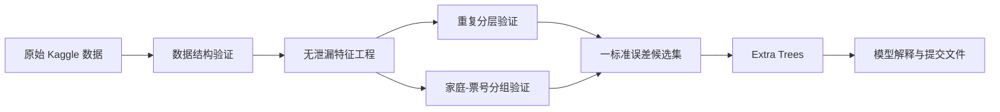

# 泰坦尼克号生存预测

[English](README.md) | 简体中文

这是一个可复现、重视数据泄漏防控的二分类项目。项目源自本科早期的一份
Titanic 练习代码，现已重构为包含数据验证、特征工程、模型比较、稳健验证、
模型解释和 Kaggle 提交记录的完整机器学习工作流。

## 项目亮点

- 将预处理、特征工程和模型封装为统一的 scikit-learn Pipeline；
- 使用 5 折 × 3 次重复分层交叉验证评估平均性能；
- 将共享家庭或票号的乘客放在同一验证折，降低关联样本泄漏；
- 使用“一标准误差规则 + 分组稳健性”选择模型；
- 通过消融实验验证新增特征，而非默认特征越多越好；
- 使用分组验证折上的置换重要性解释模型；
- 对已评分提交文件进行版本化和 SHA-256 校验。

## 结果

| 模型 | 重复 CV 准确率 | 分组验证准确率 | ROC-AUC |
|---|---:|---:|---:|
| Extra Trees | 0.8279 +/- 0.0169 | **0.8238 +/- 0.0268** | 0.8797 |
| 逻辑回归 | 0.8279 +/- 0.0261 | 0.8170 +/- 0.0240 | 0.8700 |
| 随机森林 | **0.8286 +/- 0.0199** | 0.8115 +/- 0.0285 | 0.8802 |
| 梯度提升 | 0.8271 +/- 0.0219 | 0.8103 +/- 0.0216 | 0.8827 |
| 多数类基线 | 0.6162 | 0.6162 | 0.5000 |

随机森林在普通验证中的领先仅为 0.0007，远小于随机波动；Extra Trees 在
家庭—票号分组验证中领先 0.0123。因此最终选择 Extra Trees，而不是机械选择
最高的单一均值。

| 提交版本 | 模型 | Kaggle 分数 | 变化 |
|---|---|---:|---:|
| v1 | Random Forest | 0.77751 | - |
| v2 | Extra Trees | **0.78229** | **+0.00478** |


性别是最重要的信息来源，其次是从姓名提取的称谓/长度、家庭关系和舱位等级。
这些结论来自验证折而不是训练集自身。

## 方法流程



## 项目结构

```text
titanic-portfolio/
|-- data/                     # 数据下载说明；原始 CSV 不进入 Git
|-- docs/                     # 分析、简历与面试说明
|-- outputs/submissions/      # 已评分提交文件
|-- reports/                  # 指标、消融实验与图表
|-- src/features.py           # 无泄漏特征工程
|-- src/validation.py         # 家庭-票号分组
|-- src/train.py              # 训练、评估、选模与导出
|-- tests/                    # 单元测试
|-- MODEL_CARD.md
|-- requirements.txt
`-- README.md
```

## 复现

首先在 Kaggle 接受竞赛规则并将三个 CSV 文件放入 `data/raw/`，然后执行：

```powershell
.\scripts\run_project.ps1
```

或手动执行：

```powershell
python -m venv .venv
.\.venv\Scripts\Activate.ps1
python -m pip install -r requirements.txt
python -m unittest discover -s tests -v
python -m src.train
```

训练完成后会生成模型比较、分组验证、特征消融、置换重要性、混淆矩阵、
可复用 Pipeline 和候选提交文件。

用于简历和面试的材料：

- [中文简历项目描述](docs/resume_project_zh.md)
- [中文面试讲解指南](docs/interview_guide_zh.md)
- [GitHub 发布检查清单](docs/github_release_checklist.md)
- [模型卡](MODEL_CARD.md)

## 许可证

项目代码采用 [MIT License](LICENSE)。仓库不再分发 Kaggle 竞赛原始数据。

## 项目边界

- 数据集只有 891 条训练记录，结果对数据划分仍较敏感；
- 家庭—票号分组是领域假设，不是唯一正确的验证方式；
- Kaggle 排行榜仅作为最终外部验证，不用于反复调参；
- 该模型仅用于教育和作品展示，不适用于现实人员风险决策。
