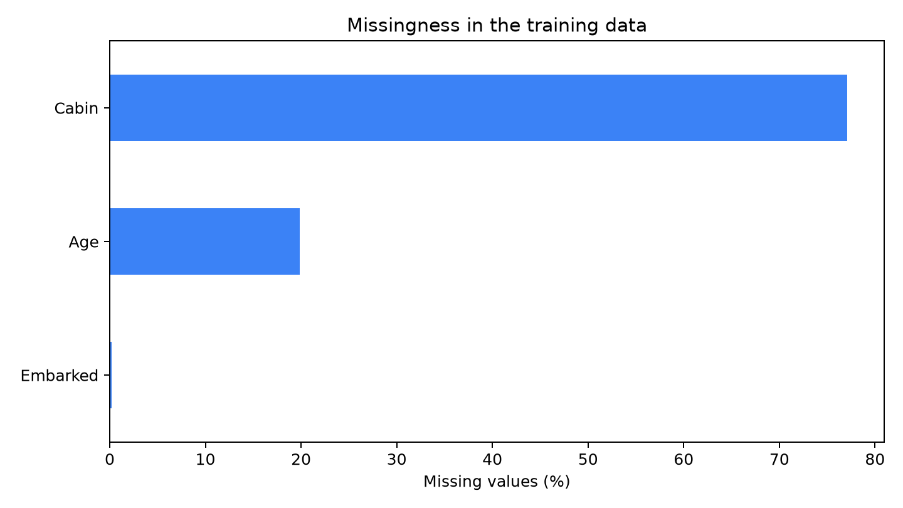
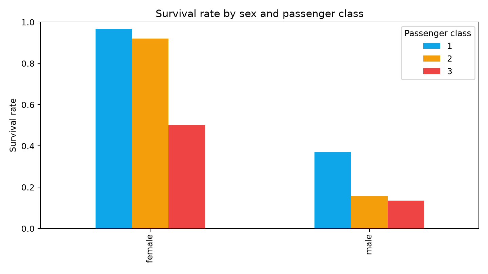
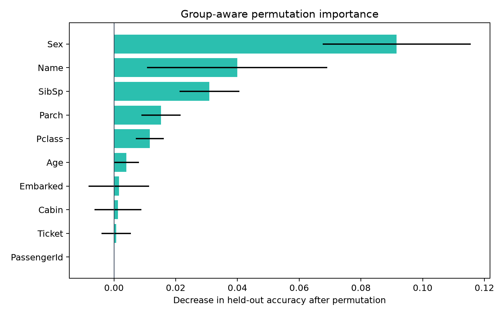

# Analysis Summary

## Question

Can passenger survival be predicted from the information available in Kaggle's
Titanic dataset while avoiding common preprocessing and validation leakage?

## Data quality

The training set contains 891 labelled passengers. Age is missing for 177
records, cabin for 687, and embarkation port for 2. The test set contains 418
passengers, including 86 missing ages, 327 missing cabins, and 1 missing fare.

## Descriptive findings

Sex and passenger class show the clearest survival-rate differences. Women had
substantially higher observed survival rates than men in every class, while
third-class passengers had lower survival rates within both sexes.

These are descriptive associations in a historical dataset, not causal claims.

## Validation design

Random stratification alone can place related passengers on both sides of a
fold. The project therefore reports two complementary estimates:

1. shuffled five-fold stratified cross-validation repeated three times;
2. five-fold stratified group validation, where passengers connected through a
   shared family identity or ticket remain in the same fold.

Model selection first forms a one-standard-error shortlist from repeated CV,
then chooses the shortlisted model with the highest group-aware accuracy.

## Model results

Random Forest had the highest repeated-CV point estimate, but its 0.0007 lead
over Extra Trees was negligible relative to fold variation. Extra Trees performed
0.0123 better in group-aware validation and was therefore selected.

The v2 Extra Trees submission scored 0.78229 on Kaggle, improving the v1 Random
Forest score by 0.00478.

## Interpretation

Sex is the dominant source feature. Name contributes through extracted title and
length, followed by family relationship counts and passenger class. Fare had a
slightly negative mean importance, but its magnitude was comparable with
cross-fold variation, so it was not removed based on that result alone.

## Conclusion

The main improvement was methodological rather than a large leaderboard gain:
the project replaced a single optimistic validation score with repeated and
group-aware evidence, selected a more stable model, and preserved an auditable
link between code, predictions, and Kaggle results.

